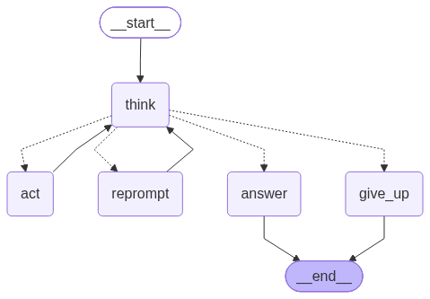
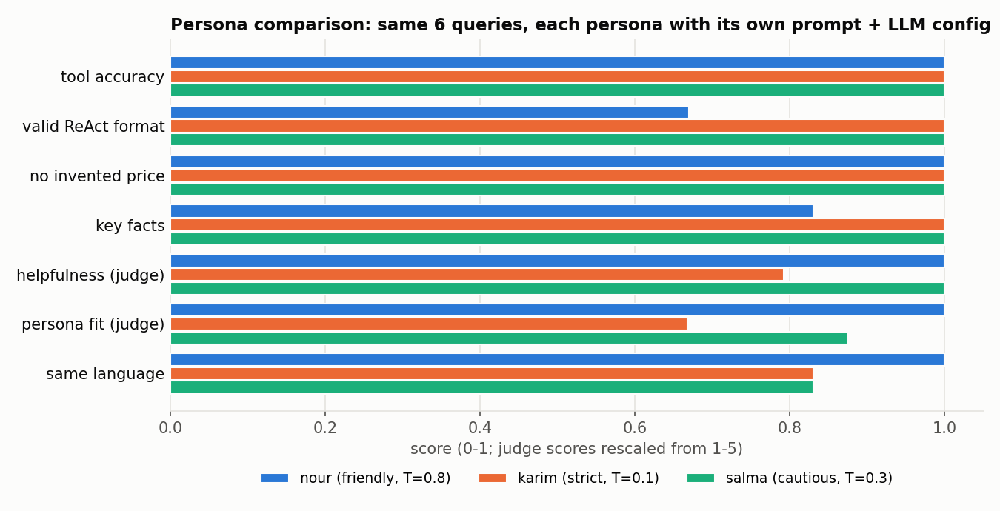

# AhmadJouni-ReActAgent-C4

A custom **ReAct agent with configurable personas** for SunCedar Solar, a fictional Lebanese home-solar company.
The ReAct loop (Thought → Action → Observation → … → Final Answer) is implemented by hand as a **LangGraph
StateGraph** on **Gemini** (native `google-genai` SDK), with three personas, four tools, and a logged experiment grid
comparing personas, LLM configurations and prompt-engineering choices.

*EECE 503P/798S: Agentic Systems · C4: Agent Personas & Thinking Mechanisms · Ahmad Jouni.
Continues [C3](https://github.com/ahmadjouni1/AhmadJouni-BusinessAgent-C3) (same business documents and lead/feedback tools).*

## Overview

| | |
|---|---|
| **Use case** | Help Lebanese homeowners tired of EDL cuts and generator subscriptions choose a solar package, get facts (prices, warranty, payment, areas), book a free site visit, and report problems. |
| **Framework** | LangGraph `StateGraph` with hand-written nodes and conditional edges. No `langgraph.prebuilt`, no `create_react_agent`, no `ToolNode`, no AgentExecutor. |
| **LLM** | `gemini-3.1-flash-lite` (agent), `gemini-3.5-flash-lite` (LLM judge); `gemini-3.8-flash` in the model-type experiment |
| **ReAct style** | Text-based: the model writes `Thought:` / `Action: tool({json})` / `Final Answer:`, and our parser detects the Action. Native function calling is not used. |
| **Tools** | `search_docs` (BM25 over the docs), `recommend_package`, `record_customer_interest`, `record_feedback` |
| **Personas** | Nour – Friendly Advisor · Eng. Karim – Strict Expert · Salma – Cautious Helper |

## Architecture



```
user message + persona + chat history
        │
        ▼
 ┌─ think ──────────── LLM call: system prompt = PERSONA + INSTRUCTIONS + TOOLS, stop at "Observation:"
 │      │ parse_react()
 │      ├─ Action: tool({...}) ──► act ── run tool ──► "Observation: ..." appended ──► back to think
 │      ├─ malformed ───────────► reprompt ── format reminder (once) ──────────────► back to think
 │      ├─ Final Answer: ... ───► answer ──► END
 │      └─ max 6 steps / still malformed ──► give_up (safe reply) ──► END
 │
 tools: search_docs ─ BM25 over 24 chunks of me/about_business.pdf + me/business_summary.txt
        recommend_package ─ sizing rules from the package table → Basic / Family / Villa
        record_customer_interest ─ validate email, print, append leads.jsonl
        record_feedback ─ print, append feedback.jsonl
```

### What the Gemini API actually honors (measured, October 2026)

| Parameter | `gemini-3.1-flash-lite` | `gemini-3.5-flash-lite` | `gemini-3.6/3.8-flash` |
|---|---|---|---|
| temperature | ✅ honored | ⚠️ accepted, ignored | ignored (Google docs) |
| top_p | ✅ honored | ⚠️ (see notebook §2.1) | ignored (docs) |
| top_k | ⚠️ accepted, no measurable effect | ⚠️ accepted, ignored | ignored (docs) |
| max_output_tokens, stop_sequences, seed | ✅ | ✅ | ✅ |
| presence / frequency penalty | ❌ HTTP 400 | ❌ HTTP 400 | ❌ HTTP 400 |

That is why the agent runs on `gemini-3.1-flash-lite`: it is the only current model where the persona configurations
change the output. Penalties are kept in the persona configs as documented intent and dropped before the API call.

## Repository layout

```
├── me/                          # business documents (from C3)
├── app.py                       # agent: LLM wrapper + cache, tools, personas, instructions, LangGraph loop, Gradio
├── experiments.py               # parameter probe, test set, grid, scoring + LLM judge, runner, charts
├── business_react_agent.ipynb   # main deliverable (generated from app.py + experiments.py sections)
├── scripts/
│   ├── build_notebook.py        # rebuilds the notebook
│   └── reflection.md            # the reflection section of the notebook
├── cache/llm_cache.jsonl        # every LLM response (re-running costs no quota)
├── experiments/                 # results.csv, traces.jsonl, chart_*.png, tool_logs/
├── docs/react_graph.png         # the LangGraph diagram
├── DEMO_SCRIPT.md               # test messages for the demo video
├── requirements.txt · .env.example · .gitignore
```

## Setup

```bash
git clone https://github.com/ahmadjouni1/AhmadJouni-ReActAgent-C4.git
cd AhmadJouni-ReActAgent-C4
pip install -r requirements.txt
cp .env.example .env        # paste your key from https://aistudio.google.com/apikey
```

## How to run

| What | Command |
|---|---|
| Notebook | open `business_react_agent.ipynb` → Run all (or `python -m nbconvert --to notebook --execute --inplace business_react_agent.ipynb`) |
| Google Colab | File → Open notebook → GitHub → this repo; add `GEMINI_API_KEY` in 🔑 Secrets (Notebook access on); Run all |
| Chat app | `python app.py` → http://127.0.0.1:7860 (persona dropdown; trace shown in collapsible boxes) |
| Experiments only | `python experiments.py` |
| Rebuild notebook | `python scripts/build_notebook.py` (after editing `app.py` / `experiments.py`) |

**Quota and cache.** The free tier allows about 500 requests/day on Flash-Lite and 20/day on Flash. Every response is
stored in `cache/llm_cache.jsonl` keyed by model + prompt + config, so re-running the notebook is free and an
interrupted experiment run resumes where it stopped. Delete the cache file to force fresh calls.

**Hugging Face Spaces.** The YAML header above configures a Gradio Space: create a Space, add `GEMINI_API_KEY` as a
secret, and push this repo to it.

## Experiment summary

See [`scripts/reflection.md`](scripts/reflection.md) and notebook §8–9 for the full tables, charts and discussion.

**Setup:** 6 fixed queries (price, package recommendation, lead, unanswerable question, complaint, Arabizi) ×
16 variants = 96 logged runs. Scores: correct tool, valid ReAct format, no invented price, key-fact recall, LLM
calls, latency, and an LLM judge (helpfulness, persona fit, same language). `quality` = mean of tool, format, price,
facts and rescaled helpfulness.

| Variant | Quality | Notes |
|---|---|---|
| **Salma – Cautious (T=0.3)** · system prompt · CoT · 1 example | **1.00** | best overall; long answers; replied to Arabizi in English |
| Karim – Strict (T=0.1) | 0.96 | most concise (37 words); weak on the complaint; English to Arabizi |
| Nour – Friendly (T=0.8) | 0.90 | most natural (judge 5/5); only persona replying in Arabizi; 2 format slips fixed by re-prompt |
| temperature 0.0 / 1.3 · top_p 0.3 · top_k 1 | 0.99 | sampling barely matters on a tool-grounded task |
| `gemini-3.5-flash-lite` | 0.80 | 4/6 format errors, empty outputs, one give-up |
| `gemini-3.8-flash` | 0.99 | slow (23.7 s), 20 requests/day, ignores sampling params |
| instructions in user message | 0.95 | claimed "I logged your question" without calling the tool |
| no rules (ablation) | 0.97 | same false claim: the rules are what make it actually log |

Across all 96 runs: right tool **96.9%**, valid format **92.7%**, **0 invented prices**, no tool names leaked into answers.
Weakest behaviour: replying in the user's language (Arabizi matched in 56% of runs).



---
*SunCedar Solar, its team, prices and policies are fictional, created for this course.*
